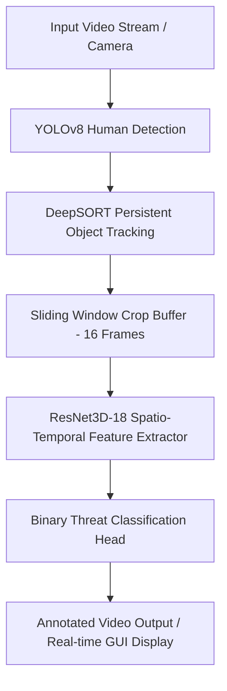

# AI Crime Detection System - Spatio-Temporal Pipeline Prototype

A modular, real-time Computer Vision (CV) pipeline designed for human detection, persistent multi-object tracking, and spatio-temporal threat assessment from video feeds.

---

## 🌟 Key Features

- **Object Detection (YOLOv8)**: Detects human subjects in video frames using YOLOv8 nano/small models.
- **Persistent Tracking (DeepSORT)**: Tracks detected individuals across frame sequences using Kalman filtering and deep Re-Identification (ReID) feature embeddings, ensuring track persistence across occlusions and crossings.
- **Spatio-Temporal Threat Assessment (3D-CNN)**: Evaluates person motion sequences using a 3D ResNet-18 backbone (`ResNet3D-18`) paired with a custom binary classification head to output anomaly/threat probability scores.
- **Hardware Acceleration**: Automatic device binding for Apple Silicon GPU (`mps`), NVIDIA CUDA (`cuda`), or CPU.
- **Inference Caching & Optimization**: Efficient 3D-CNN forward pass scheduling reduces compute overhead by caching threat scores between frame evaluation intervals.
- **Synthetic Demo Mode**: Includes an out-of-the-box synthetic video generator to test the end-to-end pipeline without external media assets.

---

## 🏗️ System Architecture



---

## 🚀 Getting Started

### Prerequisites

- Python 3.9+
- PyTorch & Torchvision
- OpenCV
- Ultralytics YOLOv8
- DeepSORT Realtime

### Installation

1. **Clone the Repository:**
   ```bash
   git clone <YOUR_REPOSITORY_URL>
   cd crime_detection_system
   ```

2. **Create and Activate a Virtual Environment:**
   ```bash
   python3 -m venv venv
   source venv/bin/activate
   ```

3. **Install Dependencies:**
   ```bash
   pip install -r requirements.txt
   ```

---

## 💡 Usage

### Demo Mode (Synthetic Video)
Run out of the box with auto-generated synthetic video:
```bash
python pipeline_prototype.py --demo
```

### Process a Local Video File
```bash
python pipeline_prototype.py --input path/to/your_video.mp4 --output output.mp4
```

### Options & Flags

| Flag | Type | Default | Description |
| :--- | :--- | :--- | :--- |
| `--input` | String | `""` | Path to input video file or RTSP stream URL. |
| `--output` | String | `"output.mp4"` | Path to save annotated output video. |
| `--demo` | Flag | `False` | Run synthetic video demonstration. |
| `--no-display` | Flag | `False` | Run headlessly without popping up a GUI window. |
| `--eval-interval` | Int | `16` | Frame interval for 3D-CNN threat re-evaluation. |
| `--max-frames` | Int | `0` | Max frames to process (0 = process full video). |
| `--yolo-model` | String | `"yolov8n.pt"` | Path/name of YOLOv8 weights. |

---

## 📜 License
MIT License
